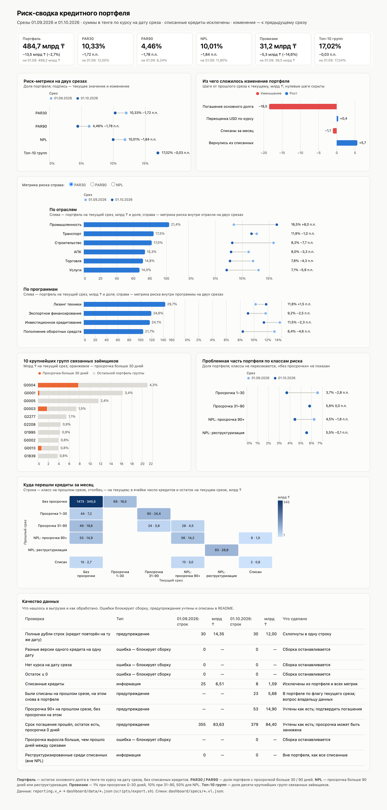

# Риск-сводка кредитного портфеля

Тестовое задание arqa «BI-разработчик (DWH и дашборды)»: витрины в PostgreSQL, семантическая модель в YAML и дашборд на Vega-Lite по синтетическому портфелю на 01.09.2026 и 01.10.2026. Сделано с Claude Code, правила работы — в [CLAUDE.md](CLAUDE.md), ошибки ИИ и что с ними сделано — в [docs/ai-notes.md](docs/ai-notes.md).

<!-- checked:start -->
**Коротко.** На 01.10.2026 портфель 484,7 млрд ₸, NPL 10,01% (−1,84 п.п. к 01.09), провизии 31,2 млрд ₸. Снижение NPL держится на 53 кредитах, у которых за месяц просрочка 90+ обнулилась, и эти «излечения» нужно подтвердить платежами. Кредит крупнейшей группы заёмщиков G0004 на 7,8 млрд ₸ ушёл в просрочку больше 30 дней. Больше половины NPL (55%) дают реструктуризированные кредиты, а не просрочка.
<!-- checked:end -->

Все итоговые числа пересчитаны вторым, независимым кодом прямо из CSV и совпали до тиына; как проверял — [ниже](#как-проверял-что-цифры-верны).

## Содержание

- [Итоговые цифры](#итоговые-цифры)
- [Три вывода для риск-комитета](#три-вывода-для-риск-комитета)
- [Дашборд](#дашборд)
- [Как проверял, что цифры верны](#как-проверял-что-цифры-верны)
- [Как запустить](#как-запустить)
- [Как я понимаю определения](#как-я-понимаю-определения)
- [Качество данных](#качество-данных)
- [Что где лежит](#что-где-лежит)

## Итоговые цифры

Портфель — остаток основного долга в тенге по курсу на дату среза, без списанных кредитов. Доли — от портфеля, изменение долей — в процентных пунктах и считается по неокруглённым долям (поэтому у топ-10 групп −0,03 п.п., хотя округлённые значения отличаются на 0,02). Таблица собирается из выгрузки `reporting.v_risk_metrics_long` командой `python3 checks/check_readme_numbers.py --write`, руками не правится.

<!-- metrics-table:start -->
| Метрика | 01.09.2026 | 01.10.2026 | Изменение к 01.09 |
|---|---:|---:|---:|
| Портфель | 498,2 млрд ₸ | 484,7 млрд ₸ | −13,5 млрд ₸ (−2,7%) |
| PAR30 | 12,05% | 10,33% | −1,72 п.п. |
| PAR90 | 6,24% | 4,46% | −1,78 п.п. |
| NPL | 11,85% | 10,01% | −1,84 п.п. |
| Провизии | 36,5 млрд ₸ | 31,2 млрд ₸ | −5,3 млрд ₸ (−14,6%) |
| Топ-10 групп | 17,04% | 17,02% | −0,03 п.п. |
| Кредитов в портфеле | 1 975 | 1 992 | +17 |
<!-- metrics-table:end -->

Точные суммы для сверки:

<!-- exact-table:start -->
| Сумма, ₸ | 01.09.2026 | 01.10.2026 |
|---|---:|---:|
| Портфель | 498 153 228 694,57 ₸ | 484 674 770 832,76 ₸ |
| Провизии | 36 512 259 066,30 ₸ | 31 171 241 408,38 ₸ |
<!-- exact-table:end -->

<!-- checked:start -->
Из чего сложилось изменение портфеля (`reporting.v_portfolio_bridge`): погашения основного долга −18,5 млрд ₸, переоценка долларовых кредитов по курсу +0,4 млрд ₸, списания за месяц −1,1 млрд ₸, возврат в портфель ранее списанных +5,7 млрд ₸.
<!-- checked:end -->

## Три вывода для риск-комитета

<!-- checked:start -->
**1. Снижение NPL с 11,85% до 10,01% держится на «излечениях», которые не подтверждены.** У 53 кредитов на 01.09 была просрочка 90+ (15,3 млрд ₸), а на 01.10 — ноль дней. Если эти «излечения» не подтвердятся, NPL на 01.10 был бы 13,09% против 11,85% на 01.09, а провизии — больше на 7,3 млрд ₸. Обнуление просрочки больше 90 дней за один месяц значит одно из трёх: заёмщик погасил всю накопленную задолженность, кредит реструктурировали без отметки (новый график обнуляет просрочку) или это ошибка выгрузки. По самой выгрузке это не различить: остаток за месяц снижается у всех кредитов, в том числе у тех, кто остался в 90+, поэтому платёж от неплатежа по остаткам не отличить. Приток в просрочку при этом не остановился: 28 кредитов на 4,5 млрд ₸ перешли из 31–90 дней в 90+, а 80 кредитов на 24,4 млрд ₸ перешли из 1–30 в 31–90 дней. Эти 80 кредитов — кандидаты в NPL на ближайшие два месяца.

*Что сделать:* до заседания подтвердить платежи и изменения графика по 53 «излечённым» кредитам у владельца данных или в платёжной системе. Туда же — 10 кредитов на 2,7 млрд ₸, которые вернулись из списанных сразу без просрочки (см. «Качество данных»).

**2. Кредит крупнейшей группы заёмщиков G0004 на 7,8 млрд ₸ ушёл в просрочку больше 30 дней.** Группа на первом месте по портфелю: 21,0 млрд ₸, или 4,3%. Её кредит L001018 на 01.10 просрочен на 40 дней, а на 01.09 у группы не было ни одного кредита с просрочкой больше 30 дней. Из-за этого кредита PAR30 отрасли «Промышленность» вырос с 8,5% до 16,5%; если бы L001018 остался в 0–30 днях, было бы 8,9%. По топ-10 групп PAR30 вырос с 10,1% до 12,9%, хотя по всему портфелю снизился с 12,0% до 10,3%. Если L001018 дойдёт до 91 дня, NPL вырастет на 1,6 п.п., а провизии на 3,1 млрд ₸ (ставка 50% вместо 10%).

*Что сделать:* рассматривать G0004 как одну группу риска, а не один договор. У группы уже есть реструктуризированный кредит в NPL, а ещё четыре её кредита прошли дату погашения без просрочки. Проверить на обесценение все девять кредитов группы и следить за L001018 до следующего среза.

**3. Больше половины NPL — реструктуризация, а не просрочка.** 93 реструктуризированных кредита на 26,9 млрд ₸ (5,5% портфеля) дают 55% NPL и 43% провизий (13,4 млрд ₸), хотя просрочка у них не больше 48 дней. Поэтому уровень NPL сильно зависит от правила выхода из статуса реструктуризации: эти 5,5% портфеля больше, чем всё изменение NPL за месяц (−1,84 п.п.). Есть и обратный риск: 362 кредита на 81,7 млрд ₸ (16,9% портфеля) уже прошли дату погашения, числятся без просрочки и не отмечены как реструктуризированные. Если это пролонгации без отметки о реструктуризации, NPL занижен.

*Что сделать:* утвердить правило выхода из реструктуризации и выяснить у владельца данных, что стоит за кредитами с истёкшим сроком без просрочки.
<!-- checked:end -->

Каждое число в выводах, записанное цифрами, взято из `reporting.v_committee_facts` (колонка `display`): `checks/check_readme_numbers.py` проверяет, что в тексте нет чисел, которых нет в выводе SQL, а `checks/verify_independent.py` пересчитывает эти факты заново из CSV. Утверждения словами («ни одного», «четыре», «девять») сверены запросами к витрине отдельно, автоматическая проверка их не видит.

## Дашборд

Семь графиков на одной странице: плитки ключевых метрик, риск-метрики на двух срезах, мост портфеля, разрезы по отраслям и программам с переключателем PAR30 / PAR90 / NPL, топ-10 групп, проблемная часть портфеля по классам риска, матрица миграции между классами и таблица качества данных. Спеки — `dashboard/specs/*.vl.json`, страница — `dashboard/index.html`.



## Как проверял, что цифры верны

Коротко: SQL-проверки падают громко и останавливают сборку; все выгрузки построчно пересчитаны вторым кодом на Python прямо из CSV, 97 414 значений без расхождений; данные, модель, выгрузка и README испорчены 20 способами, и каждую порчу ловит свой контроль; всё прогнано на PostgreSQL 16 и 17.

1. **SQL-проверки** (`sql/90_checks.sql`, 46 проверок, запускаются внутри `make build` до выгрузки): сырьё (пустые поля, даты, числа, флаги, курсы на каждую дату и валюту, дубли курсов), очищенная витрина (уникальность ключа, все строки raw учтены, суммы в валюте сходятся с raw), граничные случаи на функциях правил (13 синтетических случаев, в каждом сверяются флаги PAR30 и PAR90, корзина просрочки, NPL, ставка провизий и класс риска: 0, 1, 30, 31, 90, 91 день, реструктуризация с 0, 5, 45 и 120 днями, NULL и отрицательная просрочка, NULL во флаге реструктуризации) и на реальных граничных строках, инварианты (PAR90 ≤ PAR30, NPL = PAR90 + реструктуризированные до 90 дней, провизии вторым выражением, разрезы и мост сходятся с портфелем). Любая непрошедшая проверка останавливает сборку, и выгрузка для дашборда не перезаписывается. Перед загрузкой CSV сверяются с `data/SHA256SUMS`.
2. **Независимый пересчёт** (`checks/verify_independent.py`): второй расчёт на Python и `Decimal` прямо из CSV, без базы. Его писала отдельная сессия агента по определениям из задания и по спецификации выгрузок (колонки, коды фактов, правила событий между срезами), без доступа к SQL этого репозитория. Поэтому ошибку в коде он ловит, а ошибку в самой спецификации — нет: её искали рецензенты (пункт 8). Он сверяет все 9 выгрузок построчно, включая каждую строку очищенной витрины: 97 414 значений, расхождений 0. Суммы сравниваются точно, доли — с допуском 1e-15. Поля, которых нет в спецификации (подписи и служебные), он не сверяет и перечисляет. Самопроверка (`--self-test`) портит выгрузку 10 способами, от +0,01 ₸ до лишней строки, и требует, чтобы каждая порча была поймана.
3. **Семантическая модель** (`checks/validate_semantic.py`): формат, существование колонок и типы, а затем меры из YAML собираются в SQL так, как их собрал бы BI-инструмент. Для `loan_portfolio` это 11 содержательных сверок с `reporting.v_risk_metrics` на каждую дату: суммы, доли как отношение мер, число кредитов. Модель `risk_metrics` построена на той же вьюхе, поэтому её 7 сверок проверяют только, что на дату ровно одна строка.
4. **README** (`checks/check_readme_numbers.py`): таблица итогов совпадает с выводом SQL, а каждое число, записанное цифрами в «Коротко», выводах и разделе о качестве данных, есть в подписях выгрузок.
5. **Идемпотентность** (`scripts/test_idempotency.sh`): два прогона подряд на чистой базе дают одинаковые отпечатки (число строк и md5) всех 15 объектов `raw` и `reporting`, `raw.portfolio` не задваивается, а выгрузки совпадают с закоммиченными.
6. **Проверка проверок** (`scripts/test_controls.sh`): данные, модель, выгрузка и README портятся по одному известному способу (нет курса, валюта EUR, два курса на дату, разные версии кредита, отрицательный и нулевой остаток, неверный флаг, несуществующая дата, скачок просрочки, переименованная колонка, ошибка в YAML, +0,001 ₸ в выгрузке, чужое число в README), всего 20 случаев, и каждая порча должна быть поймана своим контролем. Сначала тест убеждается, что на исходных данных все проверки проходят.
7. **Дашборд** (`scripts/screenshot.mjs`): headless Chromium открывает страницу, ждёт отрисовки ровно 7 графиков и падает, если в консоли есть ошибка или предупреждение или какой-то файл не загрузился. Скриншот снят с этой же страницы.
8. **Рецензия перед публикацией**: в два прохода четыре независимых агента пытались сломать числа и толкования, воспроизводимость с нуля (из `git clone`) и тексты. Трое пересчитали итоговые метрики своим кодом и совпали до тиына. Найденное ими исправлено и описано в [docs/ai-notes.md](docs/ai-notes.md).

**Что эти проверки не покрывают.** В данных нет ничьих в рейтинге групп, реструктуризированных кредитов с просрочкой больше 90 дней, кредитов с датой погашения в день среза, новых и выбывших кредитов. Правила для этих случаев написаны и проверены на синтетических входах, но на реальных строках не проверены. Проверки идут после загрузки: если проверка не прошла, выгрузка для дашборда не перезаписывается, но таблицы `raw` и вьюхи `reporting` уже показывают новые данные. Вариант с Docker я не запускал: на моей машине нет Docker. Вместо него сборка и все проверки выше прогнаны на двух локальных серверах, PostgreSQL 16.15 и 17.11, и выгрузки на обеих версиях совпали побайтно.

## Как запустить

Нужны PostgreSQL 16+ и клиент `psql`, для проверок — Python 3.10+ с `pandas` и `pyyaml`, для скриншота — Node 18+ и Playwright. Команды выполняются из корня репозитория.

```bash
python3 -m venv .venv && . .venv/bin/activate && pip install -r requirements.txt
```

### Вариант 1. Docker, `postgres:16`

Сервер в контейнере, сборка и проверки с хоста: `\copy` читает CSV на стороне клиента, поэтому монтировать каталог не нужно.

```bash
docker run -d --name arqa-pg -e POSTGRES_PASSWORD=postgres -e POSTGRES_DB=arqa_bi -p 54329:5432 postgres:16
# дождаться, пока сервер начнёт принимать подключения по TCP (первый старт делает initdb)
until docker exec arqa-pg pg_isready -h localhost -U postgres -q; do sleep 1; done
PGPASSWORD=postgres make build check test
```

### Вариант 2. Локальный кластер (так собран проект)

```bash
make db           # одноразовый кластер в ./.pgdata на localhost:54329 (initdb + pg_ctl)
make build        # сверка CSV, схемы, загрузка, вьюхи, проверки, выгрузка JSON для дашборда
make check        # все проверки, падает на первой непрошедшей
make test         # идемпотентность и «проверки ловят порчу»
make stop         # остановить кластер
```

Если `initdb` и `pg_ctl` не в `PATH` (Debian и Ubuntu, Homebrew `postgresql@16`), укажите каталог: `PG_BIN=/usr/lib/postgresql/16/bin make db`. Каталог кластера меняется через `PG_DATA_DIR`.

Подключение задаётся переменными `PGHOST`, `PGPORT`, `PGUSER`, `PGPASSWORD`, `PGDATABASE` (по умолчанию `localhost:54329`, `postgres`, база `arqa_bi`), так что сборку можно направить и на свой сервер. База должна быть в UTF8 (`createdb -E UTF8 -T template0 arqa_bi`), а для `make test` пользователю нужно право создавать базы: тесты работают в отдельных базах `<PGDATABASE>_idempotency` и `<PGDATABASE>_controls` и удаляют их за собой.

### Дашборд и скриншот

Страница берёт спеки и данные через `fetch` и библиотеки Vega с CDN, поэтому её нужно открывать через HTTP и с интернетом:

```bash
python3 -m http.server 8000 -d dashboard   # затем http://localhost:8000
```

Данные для дашборда (`dashboard/data/*.json`) уже лежат в репозитории; `make build` перевыгружает их из вьюх. Проверка отрисовки и скриншот:

```bash
npm install && npx playwright install chromium
make screenshot
```

## Как я понимаю определения

| Вопрос | Как считаю | Почему |
|---|---|---|
| Дубли в выгрузке | Полностью одинаковые строки одного кредита на одну дату схлопываю. Разные версии одного кредита на одну дату останавливают сборку | В файле 30 полных дублей на каждую дату. Схлопывать разные версии молча нельзя: непонятно, какая верная |
| Курс | Строго курс на дату среза, KZT = 1. Нет курса — сборка падает, без подстановки «последнего доступного» | «По курсу на дату среза». Курс на 31.08 отличается от курса на 01.09 |
| Списанные кредиты | Исключены из портфеля, из числителей и знаменателей всех метрик, провизии по ним не считаются | «Портфель — без списанных». У списанных просрочка больше 200 дней, в числителе они завысили бы PAR90 и NPL |
| Флаг списания меняется между срезами | Беру флаг текущего среза. Кредиты, списанные на 01.09 и снова несписанные на 01.10, учитываю в портфеле 01.10 и показываю отдельно с расчётом «если списание необратимо» | Флаг среза — то, что говорит источник на эту дату. Решать, что это ошибка выгрузки, должен владелец данных, а не витрина |
| Ровно 30 и ровно 90 дней | PAR30 — просрочка больше 30 дней (с 31-го), PAR90 — больше 90 (с 91-го). 30 дней — ставка 1%, 90 дней — 10% | «Больше 30», «больше 90» и «31–90 дней». Тогда категории не пересекаются и покрывают весь портфель |
| Провизия при 0 дней | 1% | «До 30 дней» включает кредиты без просрочки: это резерв на стандартные кредиты |
| Реструктуризированный кредит с малой просрочкой | NPL и ставка 50%, даже при 0 дней | NPL по определению включает реструктуризированные, а ставка 50% — «для NPL». NPL проверяется первым |
| Кредит и с 90+, и с реструктуризацией | В NPL один раз | NPL — это «или», а не сумма двух групп |
| PAR и реструктуризация | PAR30 и PAR90 считаю только по дням просрочки | Так в задании. В части методик реструктуризированные кредиты добавляют в PAR, тогда PAR30 был бы выше |
| Концентрация | Доля десяти крупнейших групп `group_id` (не заёмщиков) в портфеле; состав топ-10 на каждую дату свой | Группа объединяет связанных заёмщиков. На 01.10 в топ-10 вошла G0013, вышла G2002 |
| Изменение к 01.09 | Доли — в п.п., суммы — в тенге и в процентах. Во вьюхах это «к предыдущему срезу» | При двух срезах предыдущий для 01.10 и есть 01.09, а с третьим срезом логика не сломается |
| Округление | Считаю в `numeric` без промежуточного округления, округляю только при показе | Тогда сверка с независимым расчётом точная, без допусков на суммы |
| Срок погашения прошёл, а просрочки нет | Считаю по `days_past_due`, как в выгрузке, и показываю в разделе «Качество данных» | Дни просрочки — источник для PAR. Пересчитывать их из даты погашения — значит придумывать данные |

## Качество данных

<!-- checked:start -->
- **Дубли.** По 30 полных копий строк на каждую дату. На 01.09 в портфель попали бы 29 лишних строк на 14,3 млрд ₸: без очистки портфель был бы завышен на 2,9%.
- **Списанные.** 25 кредитов на 01.09 и 8 на 01.10 исключены из портфеля.
- **Возврат из списанных.** 23 кредита, списанные на 01.09, на 01.10 снова в портфеле: 5,7 млрд ₸. Из них 13 кредитов на 3,0 млрд ₸ в просрочке 90+, а 10 кредитов на 2,7 млрд ₸ вернулись сразу без просрочки. Если списание необратимо, портфель на 01.10 равен 479,0 млрд ₸, а NPL 9,51%, то есть возвраты поднимают NPL на 0,50 п.п.
- **«Излечения» из 90+.** 53 кредита, см. вывод 1.
- **Срок погашения прошёл, просрочки нет.** 379 кредитов на 84,4 млрд ₸ (17,4% портфеля) на 01.10; 362 из них не отмечены как реструктуризированные, см. вывод 3.
<!-- checked:end -->
- **Чего нет.** Пустых значений, нулевых и отрицательных остатков, валют без курса, дат среза без курса, разных версий одного кредита, скачков просрочки больше числа дней между срезами, реструктуризированных среди списанных. Все эти случаи проверяются при каждой сборке.

Полный список с числами по датам — в `reporting.v_data_quality` и в таблице внизу дашборда.

## Что где лежит

```
data/                    portfolio.csv, fx.csv из задания и их SHA256 (сверяются при сборке)
sql/
  00_schemas.sql         схемы raw и reporting
  10_raw_tables.sql      таблицы raw: поля текстом + номер строки файла
  20_raw_load.sql        загрузка CSV (\copy, HEADER MATCH), перезаливка в одной транзакции
  30_reporting_rules.sql пороги PAR30/PAR90, корзина просрочки, NPL, ставка провизий, класс риска — функции, одно место
  35_reporting_format.sql форматирование чисел для подписей
  40_reporting_mart.sql  очищенная витрина: v_fx_rates, v_loans, v_portfolio
  50_reporting_metrics.sql метрики: v_top_groups, v_risk_metrics(_long), v_risk_by_dimension
  60_reporting_analysis.sql миграция, мост портфеля, качество данных
  70_committee_facts.sql числа для выводов
  90_checks.sql          проверки, падают громко
semantic/                YAML-модели loan_portfolio (кредит × дата) и risk_metrics (дата)
dashboard/
  index.html             статичная страница, рисует спеки через vega-embed
  specs/*.vl.json        спеки Vega-Lite и общая тема theme.json
  data/*.json            выгрузка вьюх reporting (v_committee_facts.json читает проверка README)
checks/                  независимый пересчёт, проверка семантики, проверка чисел README
scripts/                 сборка, выгрузка, проверки, тесты, локальный кластер, скриншот
docs/                    скриншот дашборда и заметка об ошибках ИИ
CLAUDE.md                правила, с которыми работал Claude Code
```

### Вьюхи `reporting`

| Вьюха | Строка — это | Что внутри |
|---|---|---|
| `v_fx_rates` | дата × валюта | курсы с типами |
| `v_loans` | дата × кредит | очищенная витрина: без дублей, типы, сумма в тенге, флаги PAR/NPL, класс риска, ставка провизий, номера исходных строк; включает списанные |
| `v_portfolio` | дата × кредит | портфель без списанных и аддитивные меры (`par30_amount_kzt` и др.); источник семантической модели |
| `v_risk_metrics` | дата | метрики и изменения к предыдущему срезу |
| `v_risk_metrics_long` | дата × метрика | те же метрики в длинном виде с подписями |
| `v_risk_by_dimension` | дата × разрез × значение | отрасль, программа, валюта, класс риска |
| `v_top_groups` | дата × место | топ-10 групп связанных заёмщиков |
| `v_snapshot_pairs`, `v_loan_pairs` | пара срезов × кредит | кредит до и после, события между срезами |
| `v_dpd_migration` | пара × класс × класс | матрица миграции |
| `v_portfolio_bridge` | пара × шаг | мост портфеля: погашения, курс, списания, возвраты |
| `v_data_quality` | дата × проверка | аномалии выгрузки и как обработаны |
| `v_committee_facts` | факт | числа для выводов с готовыми подписями |

Скрипты идемпотентны: `CREATE SCHEMA/TABLE IF NOT EXISTS`, `CREATE OR REPLACE VIEW/FUNCTION`, загрузка через `TRUNCATE ... RESTART IDENTITY` и `\copy` в одной транзакции.

### Семантическая модель

`semantic/loan_portfolio.yml` — кредит × дата поверх `reporting.v_portfolio`: измерения (дата, отрасль, программа, валюта, класс риска и др.) и аддитивные меры. Доли считаются как отношение двух мер, например PAR30 = `par30_amount` / `portfolio_amount`. `semantic/risk_metrics.yml` — готовые метрики поверх `reporting.v_risk_metrics`, одна строка на дату; читать её можно только в разрезе `report_date`, иначе получится среднее долей за несколько дат.
